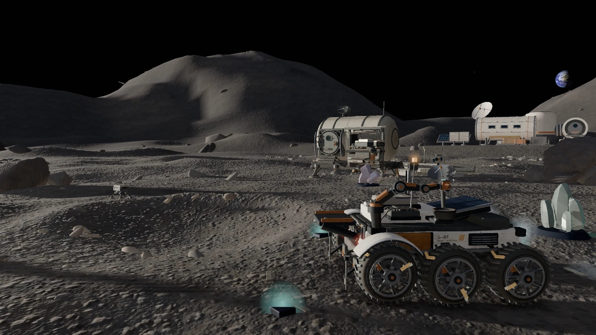

<h1 align="center">Lunar Field Station</h1>

<strong>Drive the Moon’s south pole. Leave a station for the crew that follows.</strong>

  <a href="https://audrey-cn.github.io/lunar-field-station/"><strong>Play in browser</strong></a> ·
  <a href="https://github.com/Audrey-cn/lunar-field-station/releases/download/v0.1.1/lunar-field-station.html">Download HTML</a> ·
  <a href="./docs/controls.md">Field manual</a> ·
  <a href="./README.md">简体中文</a>

Preview 0.1.1 · Three.js r182 · WebGL 2 · 5.6 MB standalone HTML

**Lunar Field Station** is a single-player browser demo made with Three.js. Follow your companion drone Zhideng across cratered terrain, collect crystal cores and survey readings, then use the field workshop to build a relay, a survey station, and a solar charging post. Return to the landing zone to send your expedition log.

## Play

Open the [browser demo](https://audrey-cn.github.io/lunar-field-station/) or [download the HTML](https://github.com/Audrey-cn/lunar-field-station/releases/download/v0.1.1/lunar-field-station.html) for offline play. Use a browser with WebGL 2 support and choose **Start expedition**. The game, graphics, and sound are bundled into the [single HTML file](./index.html), with no install or build step.

On a keyboard, drive with **WASD** or the **arrow keys**, brake with **Space**, and boost with **Shift**. Stop close to an objective and hold **E** to take a sample or use a survey instrument. Press **R** at the workshop to fabricate a kit, then at the build site to preview and deploy it. On a touchscreen, use the left joystick to drive, swipe the right side to look around, and tap the on-screen prompt to interact. [Full desktop and touch controls](./docs/controls.md)

## In the field

- **Survey and take samples.** Follow the rover’s tracks over the regolith, park at a crystal, and watch the sampling arm extract and store a core.
- **Build and return.** Bring your first samples and survey readings back to the landing zone to unlock construction. Bring the outpost online, then return to send the final log.
- **Look back at Earth.** Visit the observation point, zoom into the viewfinder and capture images in visible light, simulated far ultraviolet, or a wide view.
- **Hear the rover work.** Wheel contact and the sampling drill have their own sound layers. Scott Buckley’s piano score drops in level during sampling, and music and sound effects have separate switches.

## Development

**Fable 5.2** was the primary model for the initial prototype. Codex helped refine the game through later rounds of playtesting. Development model usage cost approximately **US$50**. The demo runs on **Three.js r182**, uses WebGL 2 for rendering and Web Audio for mixing, and is packaged as one HTML file.

## Credits

Music is [“In This Moment” by Scott Buckley](https://www.scottbuckley.com.au/library/in-this-moment/), released under [CC BY 4.0](https://creativecommons.org/licenses/by/4.0/). See [Credits and licenses](./CREDITS.md) for the complete asset list, attributions, and reuse terms.
