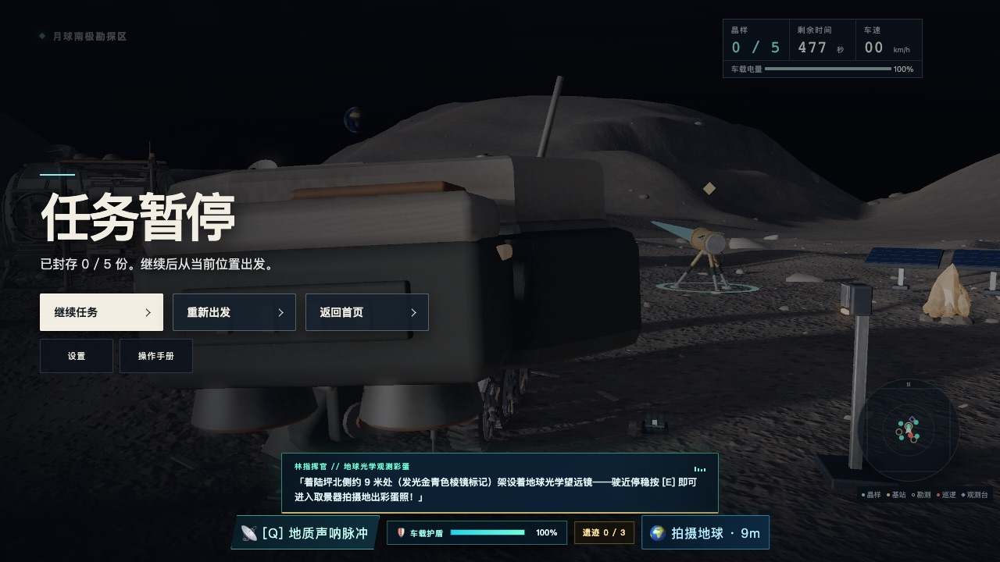

<div align="center">

# 🎮 Indie Game Lab · 独立游戏实验仓库

**Zero-dependency, single-file, 100% offline-playable Web & mobile game experiments.**

*多类型轻量化 Web / 移动端游戏原型与图形工程实验合集——单 HTML 文件，即点即玩、完全离线*

`🌐 GitHub Pages Live` · `📦 Single-File Offline` · `⚡ WebGL2 / Canvas 2D / Three.js` · `🕹️ 3 Playable Games`

<p>
  <a href="https://audrey-cn.github.io/indie-game-lab/"><strong>▶ 打开在线试玩总导航页（Game Lab Portal）</strong></a> ·
  <a href="#-项目画廊">项目画廊</a> ·
  <a href="#-项目详情">项目详情</a> ·
  <a href="#-目录结构">目录结构</a>
</p>

</div>

---

## 🖼️ 项目画廊

| 01 · 月面采集站 `v0.3.0` | 02 · 半夜扫地机：客厅摸金 `v0.9.0` | 03 · 魔女猫球 `v0.3.0` |
| :---: | :---: | :---: |
|  |  |  |
| **WebGL 2 3D 技术切片** · `1.81 MB`<br>[▶ 立即试玩](https://audrey-cn.github.io/indie-game-lab/projects/lunar-field-station/) · [F2 渲染调试](https://audrey-cn.github.io/indie-game-lab/projects/lunar-field-station/?debug=1) | **肉鸽 × 客厅搜打撤** · `867 KB`<br>[▶ 立即试玩](https://audrey-cn.github.io/indie-game-lab/projects/roomba-raid/) · [舔包种子](https://audrey-cn.github.io/indie-game-lab/projects/roomba-raid/?seed=20261122&drop=Audrey:28000:catcan) | **赛璐璐 3D 仓鼠球物理** · `627 KB`<br>[▶ 立即试玩](https://audrey-cn.github.io/indie-game-lab/projects/meowball-rush/) |

---

## 🗂️ 目录结构

本仓库采用 **Monorepo 多项目结构**，每个子目录均为可独立构建、离线单文件可玩的完整游戏项目：

```text
.
├── index.html                        # GitHub Pages 在线试玩总导航页
├── README.md                         # 仓库总览与项目索引
└── projects/
    ├── lunar-field-station/          # [01] 月面采集站（Three.js WebGL 2 3D 技术切片 · v0.3.0）
    ├── roomba-raid/                  # [02] 半夜扫地机：客厅摸金（肉鸽 × 轻度搜打撤 · v0.9.0）
    └── meowball-rush/                # [03] 魔女猫球（赛璐璐 3D 物理仓鼠球 · v0.3.0）
```

---

## 🎯 项目详情

### 01 · 月面采集站（Lunar Field Station · `v0.3.0`）
- **定位**：偏 3D 引擎与渲染工程展示的轻量化技术切片（Three.js r182 / WebGL 2 / `1.81 MB` 离线单文件 HTML）
- **核心亮点**：自定义 PCSS 软阴影 + 双边 SSAO + HDR Selective Bloom + 120Hz 6 轮悬架物理 + 0 字节程序化 Web Audio 合成器；包含「完整任务 2.0」「深空搜打撤与 3D 变形机库」「星际磁吸竞速」三大模式及手机竖/横屏适配。
- **入口**：
  - [进入子项目文档与源码](./projects/lunar-field-station/README.md) · [English README](./projects/lunar-field-station/README.en.md)
  - [在线试玩](https://audrey-cn.github.io/indie-game-lab/projects/lunar-field-station/) · [开启 F2 渲染调试面板](https://audrey-cn.github.io/indie-game-lab/projects/lunar-field-station/?debug=1)
  - [玩法与系统设计白皮书](./projects/lunar-field-station/docs/GAME_DESIGN.md) · [系统架构](./projects/lunar-field-station/docs/ARCHITECTURE.md) · [渲染管线拆解](./projects/lunar-field-station/docs/RENDERING_BREAKDOWN.md)

```sh
# 独立构建「月面采集站」
cd projects/lunar-field-station && npm install && npm run build
```

### 02 · 半夜扫地机：客厅摸金（Roomba Raid · `v0.9.0`）
- **定位**：面向微信小游戏与 X 即点即玩的男女通吃荒诞日常爽游（单手竖屏优先，兼容 PC），零依赖 Canvas 2D 单文件（`867 KB`）
- **核心亮点**：
  - 圆形大眼扫地机器人半夜客厅大战毛球/臭袜子/乐高雷，狂吸沙发缝大金（单只耳机/私房钱/金猫罐），在电量耗尽前冲回充电底座撤离；
  - **5 张统一手绘 WebP 海报地图**渐进解锁、3×9 天赋树、8 配饰、4 大超武进化组合技；
  - **v0.8–v0.9 战斗与视听升级**：超频边刷、穿透/散射/弹射弹幕、顿帧与撞墙击飞（Hitstop / Wall-Slam）、分级红箱与光环精英、5 秒波次喘息与场内互动玩具、手绘漫画风 VFX 精灵图（斩击/爆裂/火焰/边刷）以及混响 FM Rhodes Lo-Fi Funk 音频引擎；
  - 内置「机身整活改装 + 沙发底藏宝展柜 + 每日同图种子 + 朋友翻车点异步舔包链接」与 IAA 卡点商业闭环。
- **入口**：
  - [在线试玩](https://audrey-cn.github.io/indie-game-lab/projects/roomba-raid/) · [体验朋友舔包链接](https://audrey-cn.github.io/indie-game-lab/projects/roomba-raid/?seed=20261122&drop=Audrey:28000:catcan)
  - [子项目文档](./projects/roomba-raid/README.md) · [设计思维导图与商业闭环](./projects/roomba-raid/docs/DESIGN_MINDMAP_AND_LOOPS.md) · [概念美术设定稿](./projects/roomba-raid/art/concept-sheets/)

### 03 · 魔女猫球（Meowball Rush · `v0.3.0`）
- **定位**：逆向复刻经典《仓鼠球》成瘾物理玩法 + 《魔女之泉》3D 赛璐璐童话画风的轻量化单文件 3D 动作竞速（Three.js / `627 KB` 单文件）
- **核心亮点**：
  - 滑鼠推球惯性漂移与调优坡面重力物理、摆锤物理动量击飞（非一碰即死）、剩余时间结转锦标赛机制；
  - **6 款百变萌猫魔法球** + **3 大浮空立体机关赛道**；
  - **v0.2–v0.3 童话美术升级**：实时软阴影、多材质悬崖与草地浮空岛、木条绳索吊桥、绘本风树木与飘落花瓣、厚云海与渐变天穹、月纹拱门、彩虹丝带拖尾，并预留 GLB 模型挂载钩子。
- **入口**：
  - [在线试玩](https://audrey-cn.github.io/indie-game-lab/projects/meowball-rush/) · [查看源码](./projects/meowball-rush/)

```sh
# 独立构建「魔女猫球」
cd projects/meowball-rush && npm install && npm run build
```
