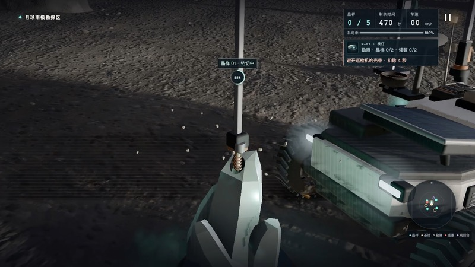
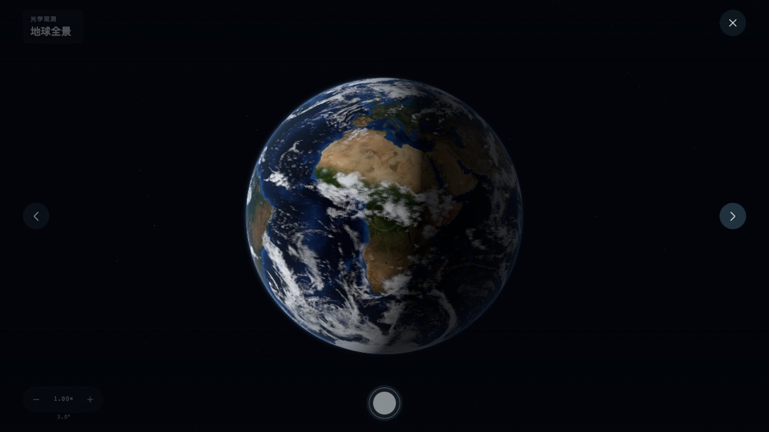

<h1 align="center">月面采集站</h1>

LUNAR FIELD STATION

<strong>驶入月球南极，为下一支车队留下一座站。</strong>

  
  

  <strong>简体中文</strong> · <a href="./README.en.md">English</a> ·
  <a href="./docs/controls.zh-CN.md">操作手册</a> · <a href="./CREDITS.md">素材与授权</a>

试玩版 0.1.1 · Three.js r182 · WebGL 2 · 5.6 MB 单文件

## 实机演示

https://github.com/user-attachments/assets/b35aa8f3-f045-4200-9282-ae3757f8c6ed

驶近晶石、钻取岩芯、收样后再出发，约 13 秒。点播放器的扬声器图标开启原声，听钢琴、车轮和钻头。

## 月面任务

你驾驶一辆六轮采样车，跟着随行无人机「枝灯」调查月球南极。在环形山里留下车辙，也为下一支车队留下能用的设备。

1. **勘测与取样。** 在晶石和勘测仪旁停稳，钻取岩芯、读取仪器，带着初勘记录返回着陆区。
2. **制造与部署。** 在工坊备好套件，用机械臂部署中继站、地形观测站和太阳能补给站。
3. **返航与回传。** 让设施上线，再回着陆区发出最后一份任务记录。途中也可以到望远镜前，拍一张地球。

| 钻取岩芯 | 月面回望地球 |
| :---: | :---: |
|  |  |

## 怎样玩

使用支持 WebGL 2 的浏览器，选择「开始完整任务」。也可以下载 [单文件 HTML](https://github.com/Audrey-cn/lunar-field-station/releases/download/v0.1.1/lunar-field-station.html) 后双击打开，离线试玩。

| 输入 | 操作 |
| --- | --- |
| **键鼠** | **WASD** 或方向键驾驶，**空格**刹车，**Shift** 推进。移动鼠标观察，长按 **E** 取样或读取仪器，按 **R** 制造和安装。 |
| **触屏** | 左侧摇杆驾驶，右侧空白处滑动观察。靠近目标，点出现的交互按钮。 |

[查看完整键位、建造与望远镜操作](./docs/controls.zh-CN.md)

## 开发

早期原型主要使用 **Fable 5.2** 开发，后续结合试玩反馈，由 Codex 协助打磨。开发期间的模型调用费用约 **50 美元**。游戏以 Three.js r182 和 WebGL 2 渲染，用 Web Audio 混音，打包为一个 HTML 文件。

配乐为 Scott Buckley 的《In This Moment》，采用 CC BY 4.0。 [素材来源、署名与许可](./CREDITS.md)
