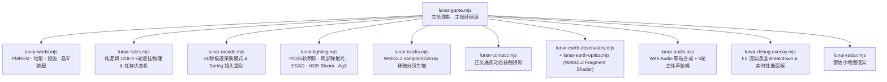

# 系统架构设计 · Architecture Overview

《月面采集站》（Lunar Field Station）采用**逻辑仿真层与渲染表现层解耦**的模块化 ES Module 架构，最终通过 `esbuild` 内联打包为单文件离线可运行的 HTML 产物（**1.81 MB / Gzip 950 KB**）。

## 总体模块关系

## 核心设计原则

### 1. 纯逻辑与渲染解耦（Deterministic Headless Simulation）
* [`src/simulation/lunar-rules.mjs`](../src/simulation/lunar-rules.mjs) **零 Three.js 依赖**，以 `PHYSICS_STEP = 1 / 120` 固定时间步长求解：
  * 6 轮独立弹簧-阻尼悬挂（压缩/回弹非对称阻尼 + 行程限位 bump stop）
  * 月球重力（`1.62 m/s²`）沿地形坡面的纵横向分力
  * 纵横向共享摩擦圆预算（`sideGrip = 8.9 * traction * sqrt(1 - 0.42 * longitudinalUse²)`）
  * 俯仰/侧倾转动惯量解算
* 这套解耦使得 Playwright 回归测试可以直接接管 `requestAnimationFrame` 实现确定性虚拟时钟自动通关。

### 2. 零外部 3D 模型依赖（Procedural Geometry + Instancing + Batching）
* 地形（[`src/world/lunar-surface.mjs`](../src/world/lunar-surface.mjs)）、6 轮采样车（[`src/world/lunar-rover.mjs`](../src/world/lunar-rover.mjs)）、科考基地（[`src/world/lunar-base.mjs`](../src/world/lunar-base.mjs)）、巡检机（[`src/simulation/lunar-scout.mjs`](../src/simulation/lunar-scout.mjs)）全部由程序化几何构建。
* 静态零件按材质通过 `mergeGeometries` 合批，碎石/碎屑/太阳能电池片/钻切火花采用 `InstancedMesh` 批处理绘制。

### 3. 移动端分层降级（Adaptive Quality Tiers）
* 自动检测触屏设备并支持通过 `F2` 调试面板热切换 `High / Balanced / Mobile Low` 三档预设：
  * 动态调节 DPR 上限、SSAO 渲染分辨率缩放（`0.50x → 0.40x → 0.32x`）、HDR Bloom 开关、以及阴影与接触阴影刷新节流间隔（`0 ms → 24 ms → 48 ms`）。

### 4. 双模式玩法设计
* **完整科考任务**：勘测取样 → 上传数据 → 工坊制造 → 机械臂部署中继站/观测站/补给站 → 返航回传（附地球望远镜观测）。
* **60 秒极速采集（Arcade Sprint）**：[`src/simulation/lunar-arcade.mjs`](../src/simulation/lunar-arcade.mjs) 面向高频正反馈与重玩欲设计，支持高速穿环瞬时采集、`×1 → ×5` 连击倍率与递升音阶提示音、低重力飞跃滞空奖励（Air Jump Bonus）以及 `localStorage` 最高分记录。

## 关键源码速查表

| 关注领域 | 核心文件 | 技术要点 |
| :--- | :--- | :--- |
| **自定义光影与后处理** | [`src/rendering/lunar-lighting.mjs`](../src/rendering/lunar-lighting.mjs) | PCSS Blocker Search、解析局部弹射光、半分辨率双边 SSAO、1/4 分辨率 HDR 选择性 Bloom、AgX |
| **稀疏虚拟纹理车辙** | [`src/rendering/lunar-tracks.mjs`](../src/rendering/lunar-tracks.mjs) | WebGL2 `sampler2DArray` + 16×16 页表索引纹理 + 1-texel gutter 无缝滤波，省 97% 显存 |
| **动态接触阴影** | [`src/rendering/lunar-contact.mjs`](../src/rendering/lunar-contact.mjs) | 车底正交高度捕获 Pass + 脏标记跳过重绘 |
| **程序化材质做旧** | [`src/rendering/lunar-building-wear.mjs`](../src/rendering/lunar-building-wear.mjs) | 顶点属性驱动离地积灰、边缘掉漆露底漆/裸金属、`dFdx/dFdy` 微法线 |
| **GPU 地球光学模拟** | [`src/rendering/lunar-earth-optics.mjs`](../src/rendering/lunar-earth-optics.mjs) | WebGL2 Fragment Shader 球面正交反投影、连续云层风场漂移、假彩远紫外极光 |
| **120Hz 车辆物理** | [`src/simulation/lunar-rules.mjs`](../src/simulation/lunar-rules.mjs) | 6 轮独立悬挂、摩擦圆、低重力姿态动力学 |
| **颗粒合成音频** | [`src/audio/lunar-audio.mjs`](../src/audio/lunar-audio.mjs) | 3 段 CC0 源声颗粒化合成 6 轮立体声胎噪、电机谐波、钻切音与连击音阶 |
| **确定性自动化 QA** | [`scripts/lunar-campaign-qa.mjs`](../scripts/lunar-campaign-qa.mjs) | Playwright 虚拟时钟端到端自动通关 + 零报错/零外联断言 |
