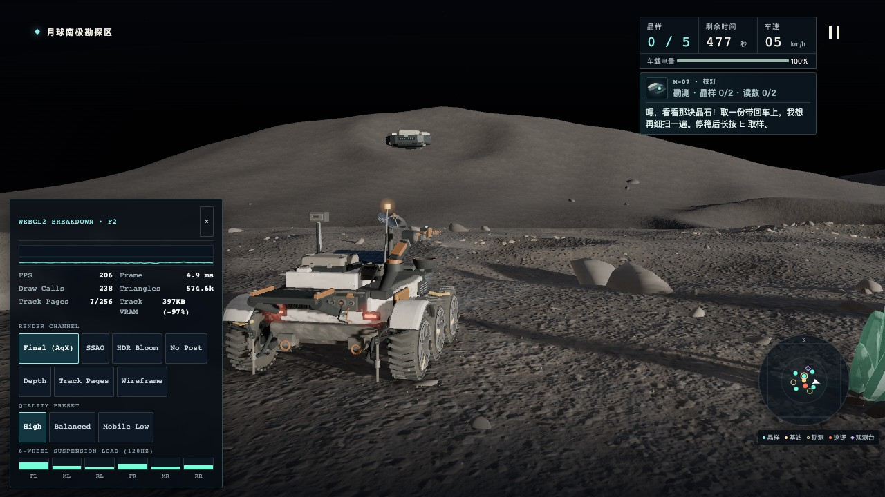

# 工程优化与性能实测记录 · Optimization & Benchmark Log

以下全部数据均由本仓库自动化脚本 [`scripts/pack-three-demo.mjs`](../scripts/pack-three-demo.mjs) 与 [`scripts/lunar-benchmark-qa.mjs`](../scripts/lunar-benchmark-qa.mjs) 在 macOS Metal WebGL 2（Headless Edge）环境下实测采集，原始 JSON 报告保留在 [`docs/bundle-stats.json`](./bundle-stats.json) 与 [`docs/benchmark-report.json`](./benchmark-report.json)。

## 1. 单文件包体极限瘦身（Playable Ads / 轻量跨端标准）

| 指标 | v0.1.1（优化前） | v0.2.1（当前版本） | 变化 |
| :--- | :---: | :---: | :---: |
| **单文件离线 HTML 总大小** | 5.318 MB (5,575,910 B) | **1.747 MB (1,831,601 B)** | **-67.2% (-3.57 MB)** |
| **Gzip 传输体积** | ~4.1 MB | **895.3 KB** | **< 900 KB 传输** |
| **内嵌 BGM 体积（Base64）** | ~2.67 MB（完整 200s 原曲） | **268.8 KB**（40s 等功率无缝循环） | **-90.0%** |
| **内嵌片头视频 + 封面** | ~1.18 MB（MP4 + WebP） | **0 KB**（改为引擎实时 3D 轨道运镜） | **-100%** |
| **天空地球重复贴图消除** | 78 KB 独立 Base64 副本 | **0 KB**（复用 `lunar-earth-color.webp` + 球面反投影） | **-100% 重复资产** |

---

## 2. GPU 渲染开销减半与运行时性能基线（v0.2.1 实测）

| 性能指标 | 优化前（v0.1.1） | 优化后（v0.2.1） | 核心手段与收益 |
| :--- | :---: | :---: | :--- |
| **Desktop Draw Calls (High)** | 473 | **234–245** | 消除 `transmission` 整场二次渲染 + 路标/晶座 `InstancedMesh` 合批（**-48.2%**） |
| **Desktop 场景面数** | 1,404,066 | **576,662** | 消除双 Pass + 自适应地形细分（184²）+ 远景碎石 LOD（**-58.9%**） |
| **Mobile Draw Calls (Low)** | 542 | **261** | 移动端低档位自动关 Bloom/AA/PCSS + 136² 地形（**-51.8%**） |
| **Mobile 场景面数** | 1,460,400 | **570,570** | 移动端减面 **-60.9%（直降 ~89 万三角面）** |
| **虚拟车辙显存占用** | 12,288 KB（全图 2048²） | **397 KB**（6–8/256 页） | WebGL2 `sampler2DArray` 稀疏分页（**-96.8% VRAM**） |
| **地球望远镜渲染** | 主线程 400 万像素 JS 循环 | **WebGL2 Fragment Shader** | 消除主线程阻塞，云层连续平滑漂移 |

### CPU → GPU 地球光学渲染迁移收益
* **优化前**：打开地球望远镜时，JS 主线程同步执行 `1152 × 1152 × 3` 像素的三角反投影与双线性插值（约 400 万次循环），在中低端设备上造成明显卡顿；云层仅靠 3 张静态图混合。
* **优化后**：直接上传 WebP 贴图至 WebGL 2 纹理，Fragment Shader 在 GPU 毫秒级实时完成反投影与光照；云层变为连续平滑漂移，且保持 `prefers-reduced-motion` 下零像素抖动（已通过 `check-earth-immersive.mjs` 桌面/竖屏/横屏三端自动化验收）。

---

## 3. 自动化回归验证矩阵

| 测试套件 | 脚本 | 覆盖范围 | 结果 |
| :--- | :--- | :--- | :---: |
| **完整战役自动通关** | [`scripts/lunar-campaign-qa.mjs`](../scripts/lunar-campaign-qa.mjs) | 10 阶段完整任务、3 晶样、2 勘测、3 设施制造部署校准、补电循环、重开菜单 | **PASS**（0 错误 / 0 外联） |
| **地球观测三端验收** | [`scripts/check-earth-immersive.mjs`](../scripts/check-earth-immersive.mjs) | 桌面 + 竖屏 + 横屏；可见光/远紫外/全景、1×–8× 缩放、动态云层与减动效、PNG 导出 | **PASS**（0 错误 / 0 外联） |
| **性能与街机模式验证** | [`scripts/lunar-benchmark-qa.mjs`](../scripts/lunar-benchmark-qa.mjs) | 三档画质切换、Breakdown 4 通道截图、60 秒街机模式采分与连击验收 | **PASS**（0 错误 / 0 外联） |
