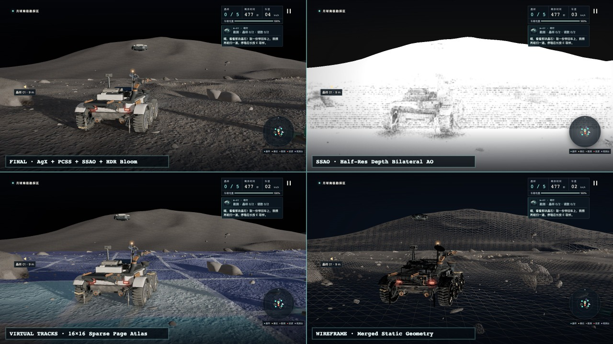
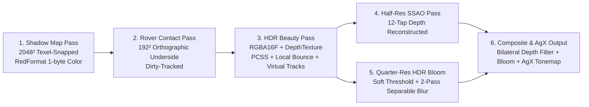

# 渲染管线技术拆解 · Rendering Pipeline Breakdown

按下游戏内 **`F2`**（或在 URL 后追加 `?debug=1`，或从“设置 → 渲染调试”开启），即可实时打开 **WebGL2 Breakdown & Profiling HUD**，逐通道检验下列每一个渲染 Pass。

## 帧内渲染管线（Per-Frame Render Graph）

---

## 1. 类 PCSS 变半影软阴影（[`src/lunar-lighting.mjs`](../src/lunar-lighting.mjs)）

* **痛点**：Three.js 内置的 `PCFShadowMap` 使用硬件比较采样器，Shader 内拿不到遮挡物的原始深度，因此无法根据“遮挡物到接收面的距离”动态改变阴影软硬。
* **实现**：通过检测 `ShaderChunk` 锚点注入 `lunarGetDirectionalShadow`，将 ShadowMap 切至 `BasicShadowMap` 以读取原始线性正交深度：
  1. **Blocker Search**：5 点旋转核搜索遮挡物平均深度；若无遮挡提前返回 `1.0`。
  2. **Penumbra Estimation**：根据 `gap = receiver - avgBlockerDepth` 线性估算半影半径。
  3. **Edge Filtering**：近距离贴地接触保持锐利双线性硬影，高处抛射阴影使用 6-tap Poisson 分布平滑柔和。
* **版本健壮性**：移除硬编码版本号检查，仅依赖 Shader 锚点检测，异常时自动打印告警并回退 `PCFShadowMap`。

## 2. 稀疏虚拟纹理车辙（[`src/lunar-tracks.mjs`](../src/lunar-tracks.mjs)）

* **痛点**：全图 `2048 × 2048 × RGB8` 车辙纹理需占用 **12.0 MB** 显存，且大部分荒漠区域从未被车轮压过。
* **实现**：
  * 将世界划分为 `16 × 16 = 256` 个虚拟瓦片（每瓦片 `128 × 128` 纹素），由一张 `16 × 16` 的 `RGFormat` 页表索引纹理维护逻辑瓦片到物理页号的映射。
  * 物理存储使用 WebGL 2 **`DataArrayTexture`（`sampler2DArray`）**，仅当车轮压过某瓦片时才按需倍增分配物理页，且通过 `addLayerUpdate(page)` 仅上传脏页。
  * **1-Texel Gutter 解决跨页接缝**：每物理页实际尺寸为 `130 × 130`（四周多留 1 圈边界纹素），写入跨边界印记时同步镜像到相邻页的 gutter，确保硬件 `LinearFilter` 在页边界零接缝。
  * 车辙同时驱动地形的 **Albedo（压实增亮 + 胎齿阴影）、Roughness 与 Normal 压平**。
* **实测收益**：典型任务路线仅分配 6–8 页，显存占用从 **12,288 KB 降至 397 KB（节省 96.8%）**。

## 3. 半分辨率深度重建 SSAO + HDR 选择性 Bloom + AgX

* **SSAO**：在 `0.50x`（移动端 `0.32–0.36x`）分辨率上，通过 `inverseProjection` 从深度缓冲重建视空间坐标与表面法线，执行 12-tap 黄金角螺旋采样；合成阶段使用**双边深度感知滤波（Bilateral Depth-Aware Filter）**避免跨物体边缘漏黑。
* **HDR Bloom**：直接复用 `HalfFloatType` 离屏 `beauty` 缓冲，先做软膝阈值提取（`threshold = 1.08`，排除天空深度），再在 `1/4` 分辨率上执行垂直 + 水平可分离 5-tap 高斯模糊，最后在 **AgX ToneMapping 之前**叠回 HDR 线性空间。车头灯、着陆区 LED 灯柱、钻切高温火花与街机信标光环均产生自然柔和的高光溢散。

## 4. 车底动态接触阴影（[`src/lunar-contact.mjs`](../src/lunar-contact.mjs)）

* 以正交相机从车底视角渲染 `192 × 192` 覆盖率与高度编码图（使用反转深度保留最贴近地面的底盘表面），投影至随车移动的 `24 × 24` 地形贴合网格上，按高度间隙指数衰减。
* 逐帧对比所有投射网格的 `matrixWorld` 与几何/实例版本号，静止时直接跳过离屏渲染。

## 5. 程序化建筑做旧（[`src/lunar-building-wear.mjs`](../src/lunar-building-wear.mjs)）

* 在合并静态网格时写入 4 分量自定义顶点属性 `equipmentFinish`（离地高度、随机种子、柱面标记、高频接触权重）。
* Fragment Shader 内基于单一 256² 打包噪声贴图，同时计算：底端月壤积灰、UV 边缘掉漆露出底漆与高金属度裸铝、基于 `dFdx/dFdy` 的屏幕空间微起伏法线、以及面板接缝 AO。

## 6. GPU WebGL 2 地球光学着色器（[`src/lunar-earth-optics.mjs`](../src/lunar-earth-optics.mjs)）

* 将原主线程 `1152 × 1152 × 3` 逐像素 JS 循环（约 400 万次迭代）全面迁移至独立 **WebGL 2 Fragment Shader**。
* 在 GPU 端完成球面正交反投影、NASA Blue Marble 地表与 MODIS 云图硬件双线性采样、纬向风场驱动的连续云层漂移、大气边缘瑞利散射，以及程序化远紫外极光/氢地冕合成。
