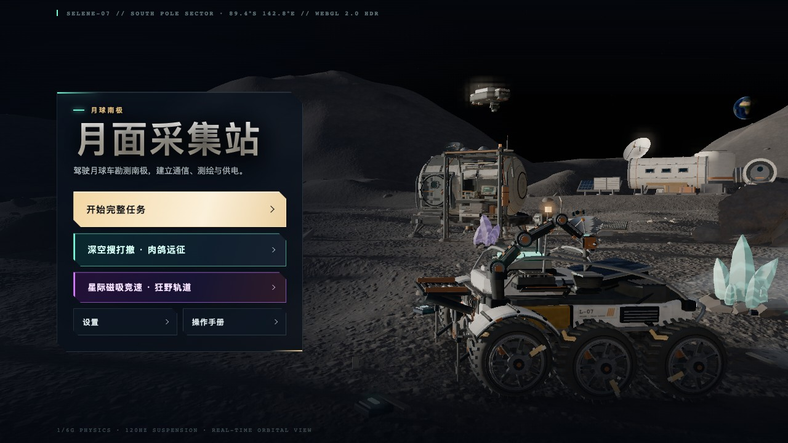
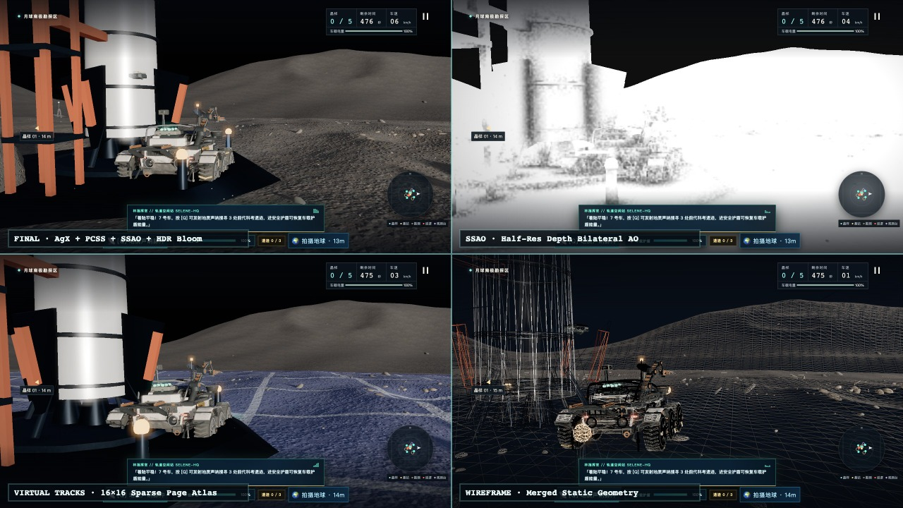
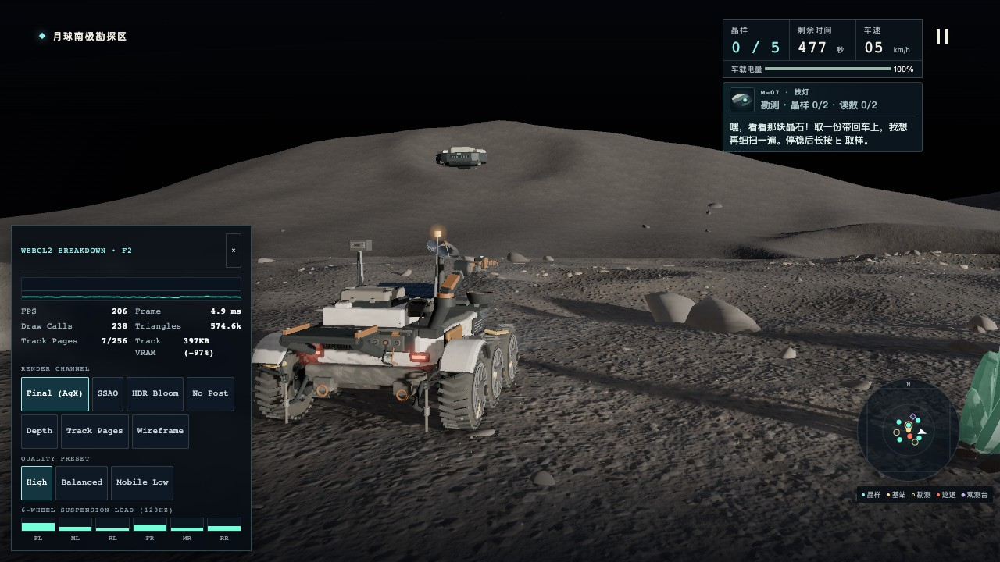
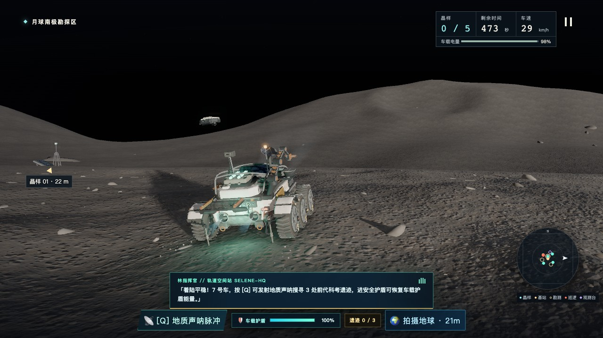

<h1 align="center">Lunar Field Station</h1>
<p align="center"><strong>A 1.91 MiB standalone WebGL 2 three-mode lunar 3D game & rendering vertical slice built with Three.js r182</strong></p>

<p align="center">
  <a href="https://audrey-cn.github.io/indie-game-lab/projects/lunar-field-station/"></a>
  <a href="https://audrey-cn.github.io/indie-game-lab/projects/lunar-field-station/?debug=1"></a>
</p>

<p align="center">
  <a href="./README.md">简体中文</a> · <strong>English</strong> ·
  <a href="./docs/GAME_DESIGN.md">Game Design</a> ·
  <a href="./docs/ARCHITECTURE.md">Architecture</a> ·
  <a href="./docs/RENDERING_BREAKDOWN.md">Rendering Breakdown</a> ·
  <a href="./docs/OPTIMIZATION_LOG.md">Benchmarks</a> ·
  <a href="./CHANGELOG.md">Changelog</a>
</p>
<p align="center"><sub>v0.4.0 · WebGL 2 · Three.js r182 · 1.91 MiB single-file HTML (833 KiB gzip) · 3 Game Modes · Live 3D Morphable Hangar · Mobile Portrait & Landscape UI · Press <code>F2</code> for live Render Breakdown</sub></p>

---



## Engineering & Graphics Highlights

Built under a **< 2.2 MB single-file offline HTML budget**, embedding four Kenney Space Kit CC0 GLB models as data URLs alongside procedural terrain, custom WebGL 2 shader passes, decoupled 120Hz vehicle dynamics, granular Web Audio synthesis, and deterministic Playwright QA.

| Subsystem | Technical Highlights | Source |
| :--- | :--- | :--- |
| **Custom Lighting & Post** | Patched **PCSS variable-penumbra shadows**, analytical local bounce irradiance, half-res depth-reconstructed bilateral **SSAO**, quarter-res **HDR selective Bloom**, and **AgX** tonemapping | [`src/rendering/lunar-lighting.mjs`](./src/rendering/lunar-lighting.mjs) |
| **Sparse Virtual Wheel Tracks** | WebGL 2 `sampler2DArray` + 16×16 page-directory indirection + 1-texel gutter borders; reduces track VRAM from **12 MB to 397 KB (-96.8%)** | [`src/rendering/lunar-tracks.mjs`](./src/rendering/lunar-tracks.mjs) |
| **Dynamic Contact Shadows** | 192² orthographic underside-height pass with dirty tracking, projected onto uneven terrain | [`src/rendering/lunar-contact.mjs`](./src/rendering/lunar-contact.mjs) |
| **Procedural Weathering** | Vertex-attribute (`equipmentFinish`) regolith dust accumulation, UV-edge paint chipping to bare alloy, and `dFdx/dFdy` micro-normal relief | [`src/rendering/lunar-building-wear.mjs`](./src/rendering/lunar-building-wear.mjs) |
| **GPU Earth Optics Shader** | WebGL 2 Fragment Shader inverse orthographic projection, continuous wind-driven MODIS cloud drift, atmospheric limb glow, and far-UV aurora simulation | [`src/rendering/lunar-earth-optics.mjs`](./src/rendering/lunar-earth-optics.mjs) |
| **120Hz Rover Physics** | Engine-agnostic simulation: 6-wheel spring-damper suspension, 1.62 m/s² lunar gravity, traction ellipse, pitch/roll inertia | [`src/simulation/lunar-rules.mjs`](./src/simulation/lunar-rules.mjs) |
| **Granular Web Audio** | 3 CC0 clips granulated into 6 stereo-panned wheel tread loops, motor harmonics, drill acoustics, and ascending combo chimes | [`src/audio/lunar-audio.mjs`](./src/audio/lunar-audio.mjs) |
| **Deterministic E2E QA** | Virtualized `requestAnimationFrame` Playwright autopilot clearing all 10 campaign stages + automated multi-viewport profiling | [`scripts/lunar-campaign-qa.mjs`](./scripts/lunar-campaign-qa.mjs) |

---

## Live Render Breakdown (Press `F2` In-Game)

Press **`F2`** (or open with `?debug=1`) to inspect FPS sparklines, draw calls, triangle counts, sparse track VRAM savings, live 6-wheel suspension load bars, live quality tier switching (`High / Balanced / Mobile Low`), and 7 render breakdown views.



| Live Breakdown & Profiler (`F2`) | Campaign 2.0 · Gameplay Action |
| :---: | :---: |
|  |  |

---

## Optimization Summary (v0.1.1 → v0.2.1)

| Metric | v0.1.1 | v0.2.1 | Improvement |
| :--- | :---: | :---: | :---: |
| **Standalone HTML Size** | 5.32 MB | **1.75 MB (895 KB gzip)** | **-67.2%** (Playable-ad grade) |
| **Desktop / Mobile Draw Calls** | 473 / 542 | **245 / 261** | **-48.2% / -51.8%** (eliminated transmission double-pass + batching) |
| **Desktop / Mobile Triangles** | 1.40M / 1.46M | **577k / 571k** | **-58.9% / -60.9%** (adaptive terrain + far rock LOD) |
| **Wheel Track VRAM** | 12.0 MB (full 2048²) | **397 KB** (sparse paging) | **-96.8% VRAM** |
| **Earth Observatory Render** | 4M-pixel CPU JS loop | **WebGL 2 Fragment Shader** | Eliminates main-thread freeze |

## Build & Verify Locally

```sh
npm install
npm run build        # Build <2 MB standalone index.html
npm run build:qa     # Build deterministic QA bundle
npm run qa:campaign  # Run full 10-stage Playwright autopilot campaign test
npm run qa:earth     # Run desktop + mobile Earth observatory suite
npm run qa:bench     # Run performance benchmark + Arcade + breakdown captures
```

## Credits & Workflow

Early prototyping explored AI-assisted workflows (Fable 5.2 + Codex), followed by hands-on engineering passes covering `<2 MB` single-file optimization, GPU Earth shader migration, HDR selective Bloom, real-time Render Breakdown tooling, modular decomposition, and deterministic Playwright QA.

Music in the lean public playable is an original zero-byte procedural deep-space synth (generated live with Web Audio, no embedded audio files). “In This Moment” by Scott Buckley (CC BY 4.0) is the licensed source score, retained in source and used in the v0.1.1 README demo clip. Full attributions in [`CREDITS.md`](./CREDITS.md).
