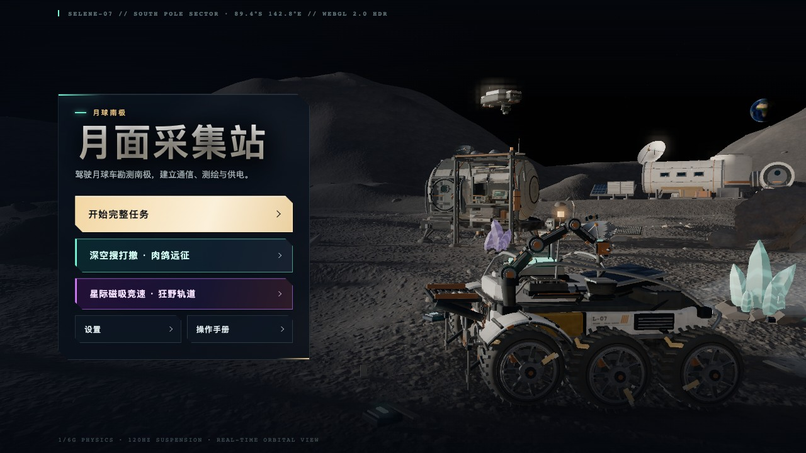
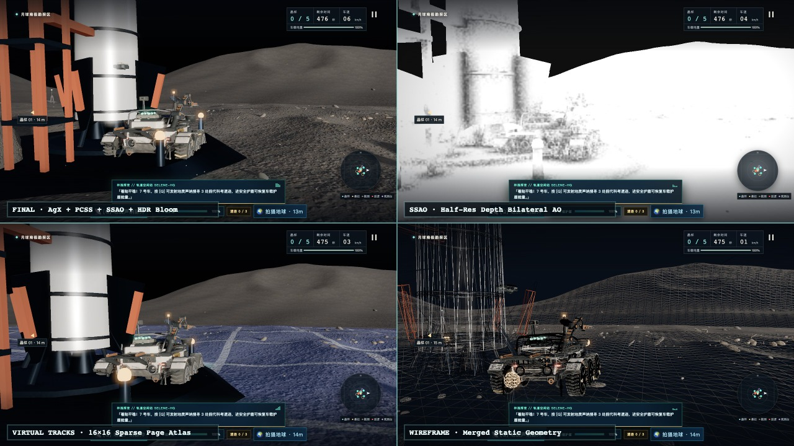
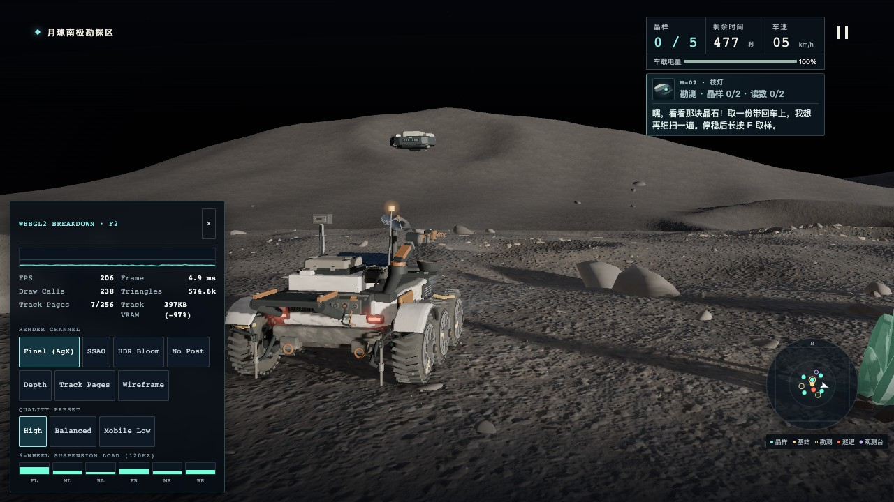
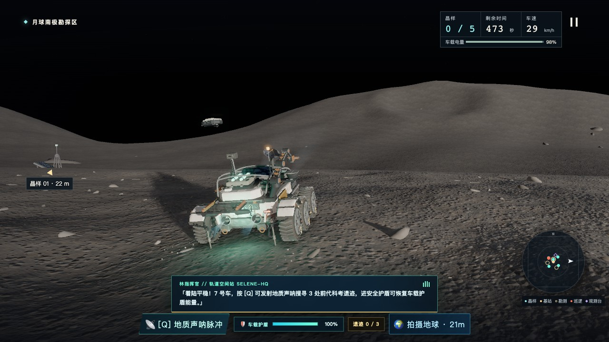
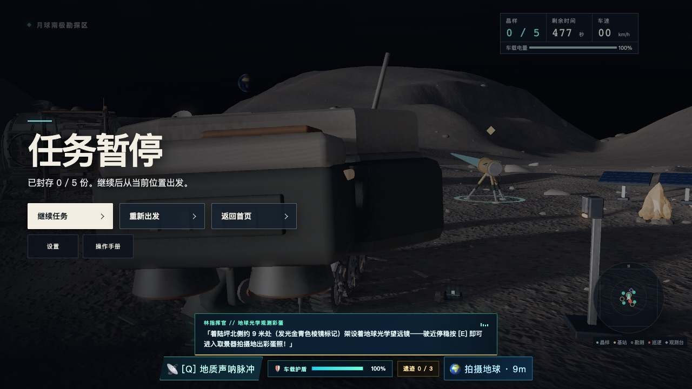
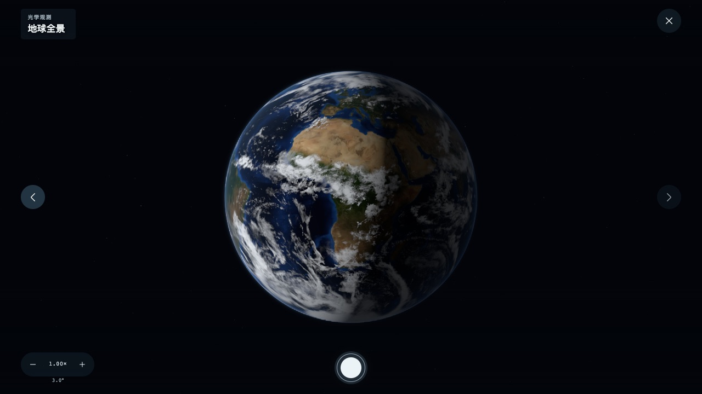
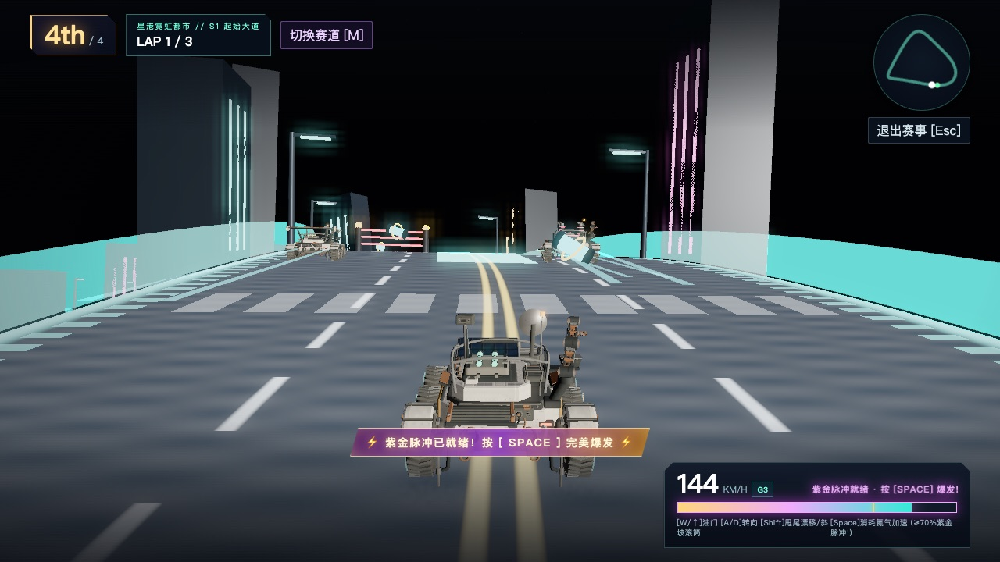
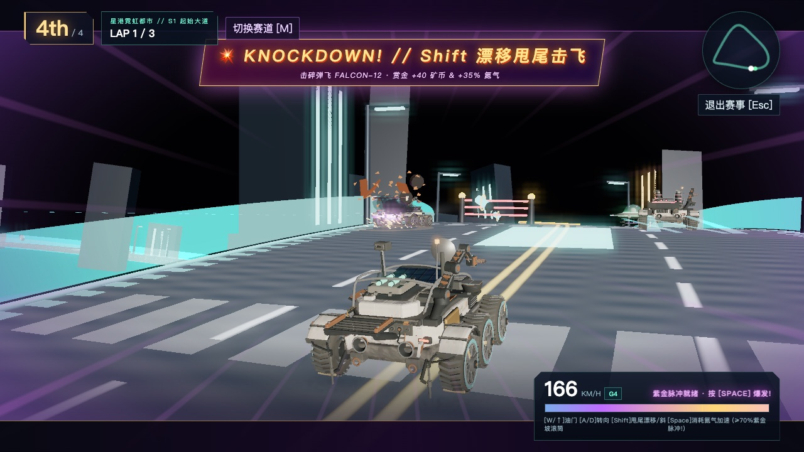
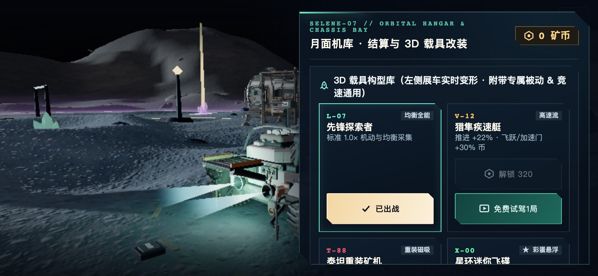
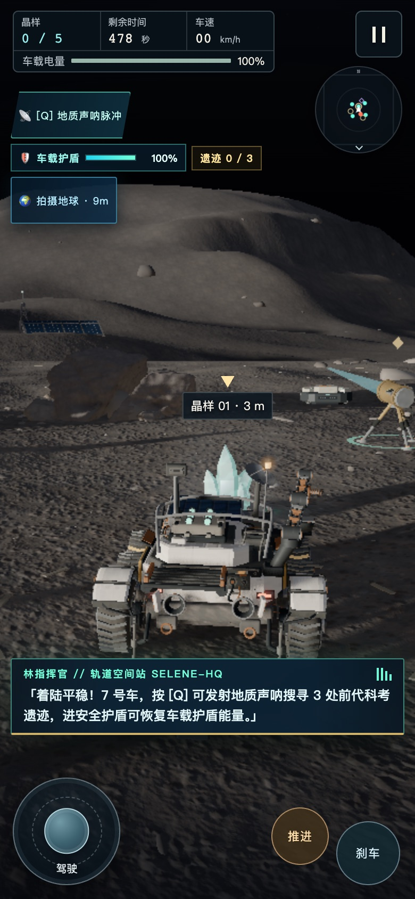

<h1 align="center">月面采集站 · Lunar Field Station</h1>
<p align="center"><strong>1.81 MB 单文件离线可运行的 WebGL 2 三模式月面 3D 游戏与图形技术切片（Three.js r182）</strong></p>

<p align="center">
  <a href="https://audrey-cn.github.io/indie-game-lab/projects/lunar-field-station/"></a>
  <a href="https://audrey-cn.github.io/indie-game-lab/projects/lunar-field-station/?debug=1"></a>
</p>

<p align="center">
  <strong>简体中文</strong> · <a href="./README.en.md">English</a> ·
  <a href="./docs/GAME_DESIGN.md">玩法与设计白皮书</a> ·
  <a href="./docs/ARCHITECTURE.md">系统架构</a> ·
  <a href="./docs/RENDERING_BREAKDOWN.md">渲染管线拆解</a> ·
  <a href="./docs/OPTIMIZATION_LOG.md">性能优化实测</a> ·
  <a href="./CHANGELOG.md">更新日志</a>
</p>
<p align="center"><sub>v0.3.0 · WebGL 2 · Three.js r182 · 1.81 MB 单文件（Gzip 806 KB） · 3 大玩法模式 · 3D 实时变形机库 · 手机竖/横屏全适配 · 按 <code>F2</code> 开启实时渲染 Breakdown</sub></p>

---



## 工程与渲染亮点（点击直达核心源码）

本项目在 **< 2 MB 极限单文件包体约束** 下，不依赖外部 3D 模型资产，完整构建了程序化 PBR 月面场景、自定义 WebGL 2 图形管线、解耦式 120Hz 车辆动力学、颗粒合成音频与确定性自动化测试。

| 技术模块 | 核心实现亮点 | 核心源码 |
| :--- | :--- | :--- |
| **自定义光影与后处理** | 注入 ShaderChunk 实现类 **PCSS 变半影软阴影**、车底/工坊解析局部弹射光、半分辨率深度重建双边 **SSAO**、1/4 分辨率 **HDR 选择性 Bloom** 与 **AgX** 映射 | [`src/rendering/lunar-lighting.mjs`](./src/rendering/lunar-lighting.mjs) |
| **稀疏虚拟纹理车辙** | WebGL 2 `sampler2DArray` + 16×16 页表索引纹理 + 1-texel gutter 消除跨页滤波接缝；按需分配 128² 瓦片，实测显存从 **12 MB 降至 397 KB（-96.8%）** | [`src/rendering/lunar-tracks.mjs`](./src/rendering/lunar-tracks.mjs) |
| **车底动态接触阴影** | 192² 正交底视高度捕获 Pass + 脏标记跳过重绘，实时贴合崎岖月面投射底盘阴影 | [`src/rendering/lunar-contact.mjs`](./src/rendering/lunar-contact.mjs) |
| **程序化材质做旧** | 基于自定义顶点属性 `equipmentFinish` 驱动离地积灰、UV 边缘掉漆露底漆与裸金属、`dFdx/dFdy` 微法线 | [`src/rendering/lunar-building-wear.mjs`](./src/rendering/lunar-building-wear.mjs) |
| **GPU 地球光学着色器** | WebGL 2 Fragment Shader 实时完成球面正交反投影、连续风场云层漂移、大气边缘散射与假彩远紫外极光 | [`src/rendering/lunar-earth-optics.mjs`](./src/rendering/lunar-earth-optics.mjs) |
| **120Hz 解耦车辆物理** | 零引擎依赖纯逻辑层：6 轮独立弹簧阻尼悬挂、月球 1.62 m/s² 重力、纵横向摩擦椭圆、俯仰/侧倾惯量 | [`src/simulation/lunar-rules.mjs`](./src/simulation/lunar-rules.mjs) |
| **Web Audio 颗粒合成** | 仅用 3 段 CC0 采样实时粒化合成 6 轮立体声像胎噪、电机谐波、钻切声与连击递增音阶 | [`src/audio/lunar-audio.mjs`](./src/audio/lunar-audio.mjs) |
| **确定性自动化 QA** | Playwright 接管 `requestAnimationFrame` 实现虚拟时钟 10 阶段全流程自动通关 + 三端性能基线采集 | [`scripts/lunar-campaign-qa.mjs`](./scripts/lunar-campaign-qa.mjs) |

---

## 实时渲染 Breakdown（游戏内按 `F2` 一键切换）

游戏内置可交互的 **WebGL2 Breakdown & Profiling HUD**（[`src/ui/lunar-debug-overlay.mjs`](./src/ui/lunar-debug-overlay.mjs)），支持实时查看帧时间曲线、Draw Calls、面数、虚拟车辙显存占用、6 轮 120Hz 实时载荷，并在 `Final / SSAO / HDR Bloom / No Post / Depth / Track Pages / Wireframe` 与三档画质预设间实时切换。



| 实时性能与调试面板（`F2`） | 完整任务 2.0 · 实机动作帧 |
| :---: | :---: |
|  |  |

---

## 三大玩法模式与全端交互体验（v0.3.0）

1. **完整任务 2.0（Campaign 2.0）**（[`src/simulation/lunar-campaign-plus.mjs`](./src/simulation/lunar-campaign-plus.mjs)）：64m×64m 环形山开放盆地、轨道空降开场、中继激光链路/观测站六边形护盾穹顶/太阳能磁轨建设、`[Q]` 地质声呐搜寻遗迹、太阳耀斑与微陨石事件、**地球光学望远镜双层动态云流拍照彩蛋**，以及 SLN-07 火箭点火升空终局。
2. **深空搜打撤 · 肉鸽远征 & 3D 实时变形机库**（[`src/simulation/lunar-extraction.mjs`](./src/simulation/lunar-extraction.mjs)）：4 种动态月面地貌、低矮柔和收缩电磁风暴圈（联动雷达虚线圈）、野外应急中继站/跳台/陨石核、三选一战术卡牌，以及 4 台可实时 3D 变形载具与免费试驾/悬赏经济闭环。
3. **星际磁吸竞速 · 狂野轨道（Orbital Mag-Lev GP）**（[`src/simulation/lunar-race.mjs`](./src/simulation/lunar-race.mjs)）：星港霓虹都市 / 赤峡熔岩矿区 / 天穹 360° 反重力星环三大专属 3D 赛道、5 档渐进加速与惯性滑行尾段、3D 氦-3 能量瓶续杯氮气、写实撞飞特写与 4 层物理碰撞音效。

| 完整任务 2.0 & 地球望远镜彩蛋 | WebGL 2 双层动态云流地球观测 |
| :---: | :---: |
|  |  |

| 星际磁吸竞速 · 氦-3 能量瓶赛道 | 写实撞毁击飞特写 |
| :---: | :---: |
|  |  |

| 手机横屏 3D 变形机库展厅 | 手机竖屏触控零遮挡布局 |
| :---: | :---: |
|  |  |

> 完整玩法循环、经济模型与多端设计详解见 [`docs/GAME_DESIGN.md`](./docs/GAME_DESIGN.md)。

## 优化成果速览（v0.1.1 → v0.3.0）

| 优化维度 | 优化前 | 优化后 | 收益 |
| :--- | :---: | :---: | :---: |
| **单文件离线包体（含全三模式）** | 5.32 MB（单模式） | **1.81 MB（Gzip 806 KB）** | **-66.0%**（0 字节程序化深空合成音替代 275 KB 音频） |
| **桌面 / 移动 Draw Calls** | 473 / 542 | **245 / 261** | **-48.2% / -51.8%**（消除 `transmission` 双 Pass + 合批） |
| **桌面 / 移动场景面数** | 1.40M / 1.46M | **577k / 571k** | **-58.9% / -60.9%**（自适应地形细分 + 远景 LOD） |
| **虚拟车辙显存占用** | 12.0 MB（全图 2048²） | **397 KB**（稀疏分页按需分配） | **-96.8% VRAM** |
| **地球观测渲染** | JS 主线程 400 万像素循环 | **WebGL 2 Fragment Shader** | 消除主线程阻塞，云层连续平滑漂移 |

> 完整实测数据、渲染 Pass 图解与模块架构请查阅：[`docs/ARCHITECTURE.md`](./docs/ARCHITECTURE.md) · [`docs/RENDERING_BREAKDOWN.md`](./docs/RENDERING_BREAKDOWN.md) · [`docs/OPTIMIZATION_LOG.md`](./docs/OPTIMIZATION_LOG.md)

---

## 本地构建与自动化验收

```sh
npm install
npm run build        # 构建 <2 MB 单文件 index.html
npm run build:qa     # 构建带确定性 QA 钩子的 lunar-qa.html
npm run qa:campaign  # Playwright 自动驾驶跑完 10 阶段完整战役
npm run qa:earth     # 桌面 / 竖屏 / 横屏三端地球望远镜验收
npm run qa:bench     # 性能基线采集、Arcade 验收与 Breakdown 截图生成
```

## 操作简览

| 输入 | 操作 |
| :--- | :--- |
| **键鼠** | `WASD` / 方向键驾驶，`空格` 刹车，`Shift` 推进，鼠标观察，长按 `E` 取样/勘测，`R` 制造/部署，`F2` 打开渲染调试面板。 |
| **触屏** | 左侧摇杆驾驶，右侧滑动观察；靠近目标点击交互按钮；自动启用移动端轻量渲染预设。 |

完整操作说明见 [`docs/controls.zh-CN.md`](./docs/controls.zh-CN.md)。

## 开发方式与素材署名

项目早期原型借助 **Fable 5.2** 快速探索，后续结合试玩与性能剖析，借助 AI 编码工具链迭代推进，并由开发者主导完成**包体极限瘦身、GPU Shader 迁移、HDR Bloom 与 Breakdown 调试管线、架构拆解以及 Playwright 端到端基准测试**。

配乐为 Scott Buckley 的《In This Moment》（CC BY 4.0，单文件轻量版使用 40 秒无缝循环片段）。所有第三方素材来源与许可证详见 [`CREDITS.md`](./CREDITS.md)。
