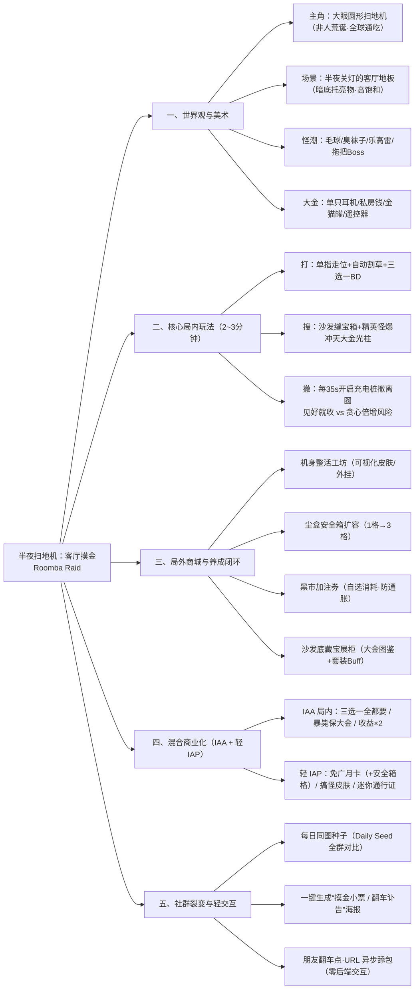
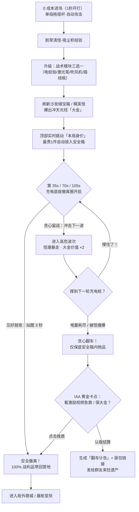
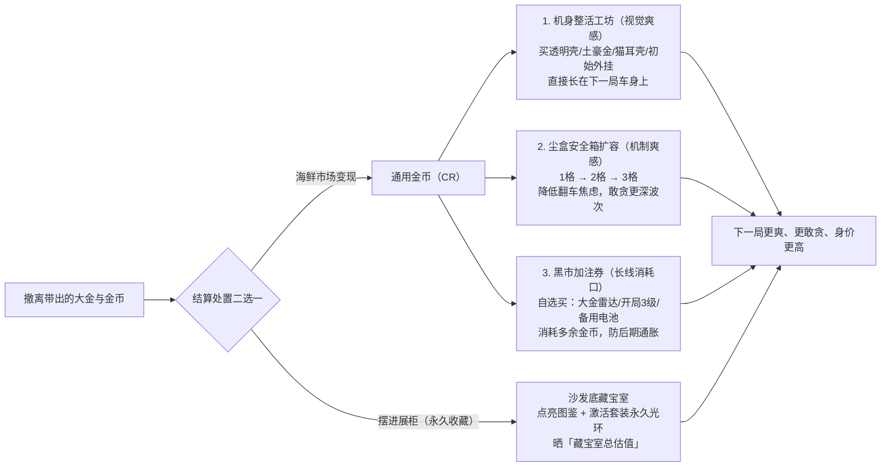
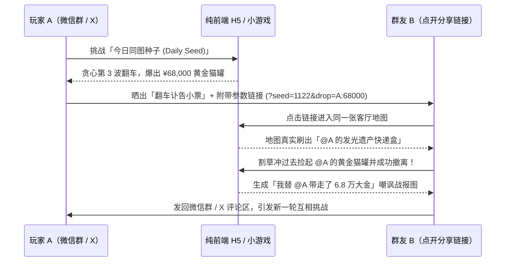

# 《半夜扫地机：客厅摸金 / Roomba Raid》
## 整体架构思维导图、玩法与商业化闭环设计（含客群画像与缺陷自检）

---

## 1. 目标客群画像与双端分发策略

本项目旨在同时吃透 **微信小游戏泛用户** 与 **X（Twitter）/ 社群即点即玩用户**，核心人群覆盖 **18–38 岁男女通吃** 的轻中度碎片化玩家：

| 维度 | 微信小游戏泛用户（国内核心盘） | X / 海外 Web 即点即玩用户（破圈与口碑盘） | 共性最大公约数（产品锚点） |
| :--- | :--- | :--- | :--- |
| **使用场景** | 通勤、午休、睡前 2–5 分钟单手竖屏 | 刷信息流看到 10 秒动图/晒图卡片顺手点开 | **0 下载、3 秒开打、单局 2–3 分钟** |
| **审美偏好** | 拒绝血腥/压抑/重度暗黑；偏爱 Q 弹可爱、色彩明快、生活化玩梗 | 偏爱高辨识度 Indie 风格、荒诞反差 Meme（如“Roomba 绑刀”） | **暗夜客厅干净底板 + 高饱和潮玩 Q 弹角色与弹幕** |
| **心理诉求** | 极低学习成本、解压割草、爱看“出大金”的暴富数字跳动、爱晒群榜 | 喜欢构筑（BD）组合、极限贪心操作、喜欢发“离谱翻车图”玩梗 | **0 带入门槛的“贪婪撤离博弈” + 搞笑大金 + 晒小票** |
| **变现容忍度** | 极高 IAA 激励视频接受度（尤其在“保住大金/翻倍收益”节点） | 排斥强制插屏广告，接受“自愿观看激励”与“外观/收藏支持” | **0 强制弹窗，100% 利益驱动型自愿激励 + 轻内购** |

---

## 2. 整体产品架构图（思维导图版）

---

## 3. 核心游戏性与四大闭环拆解

### 3.1 局内 2 分钟核心循环（0 带入搜打撤）

### 3.2 局外经济与商城爽感闭环（解决“带出来的钱干什么”）

### 3.3 商业化混变卡点设计（IAA + 轻 IAP）

| 商业化节点 | 类型 | 触发时机 | 玩家心理动机 | 预期转化评级 |
| :--- | :---: | :--- | :--- | :---: |
| **三选一「我全都要」** | IAA（激励视频） | 局内同时刷出 2 张以上核心金卡 | “这把胡了，全拿直接起飞！” | ⭐⭐⭐⭐⭐ |
| **翻车急救 / 保住最贵大金** | IAA（激励视频） | 贪心暴毙、眼看 ¥68,000 大金要爆光 | 极强损失厌恶，几乎无抵触心理 | ⭐⭐⭐⭐⭐ |
| **安全撤离「收益 ×2」** | IAA（激励视频） | 单局摸到稀有大金成功撤离后 | “刚赚了 5 万，看一眼直接变 10 万！” | ⭐⭐⭐⭐ |
| **免广特权月卡（含安全箱 +1 格）** | 轻 IAP | 玩过 5 局以上、触发过 2 次激励广告后 | 跳过广告 + 永久多保 1 件大金 | ⭐⭐⭐⭐ |
| **搞怪外观直购 / 迷你通行证** | 轻 IAP | 7 天/14 天主题活动（如“猫主子赛季”） | 社交展示、可爱外观收集 | ⭐⭐⭐ |

### 3.4 社群裂变与“零服务器异步舔包”闭环

---

## 4. 搭建期深度自查：6 个潜在设计缺点与修正方案

在还没写第一行代码前，我们先主动“找茬”，把最容易让游戏上线后留存崩掉的 **6 个隐患** 提前暴露并给出修正案：

### 缺点 1：单屏竞技场太小，会导致「撤离」缺乏空间拉扯感
- **问题分析**：如果地图完全只有一个手机屏幕大，充电桩永远就在脚边 1 秒能走到，“冲刺撤离”的紧张感会大打折扣。
- **修正方案**：采用 **「紧凑 2.5×2.5 屏客厅」**（类似《土豆兄弟》的 1.8 倍视野），搭配清晰的边缘方向箭头与地面发光导引线。充电桩刷在客厅对角线，玩家需要穿越 4~6 秒的怪潮才能冲进去，既不会像大地图那样跑断腿，又有极强的冲刺压迫感。

### 缺点 2：新手第一局如果不懂撤离直接贪死，会带来强烈挫败感
- **问题分析**：泛休闲用户如果第一局辛苦打了 1 分钟结果全爆光，可能直接关掉游戏。
- **修正方案**：**首局保护脚本**——第 1 局开局 20 秒必出一个发光“单只耳机（¥8,800）”并自动锁进 1 号安全箱；第 35 秒充电桩首次开启时弹出高亮箭头与轻指引“电量告急！进绿圈带走大金！”，确保 95% 新手首局都能爽快完成一次“摸金→撤离→商城买第一个外挂”的完整正向闭环。

### 缺点 3：安全箱如果升得太满，会破坏“搜打撤”的心跳刺激感
- **问题分析**：如果玩家把安全箱升到 6 格，每局所有大金都锁死了，死了也不痛不痒，撤离博弈就名存实亡。
- **修正方案**：**严格锁死安全箱上限为 `1`（初始）→ `2`（金币扩容）→ `3`（顶级/月卡）**，且**只有单件体积/品质最高的大金能进安全箱，其余散装金币与普通战利品必须靠撤离带走**。此外，设置**“撤离全额连胜倍率”**（连撤 2 局收益 ×1.3、连撤 3 局 ×1.6，暴毙断连），让老玩家永远有“必须活着回充电桩”的冲动。

### 缺点 4：纯单机数值商城容易在玩了 10 局后陷入“钱花不完 / 数值膨胀”
- **问题分析**：很多肉鸽小游戏前 5 局很爽，第 10 局把天赋点满后钱变成一串废数字。
- **修正方案**：引入 **「黑市加注券」消耗口**（每局可自选花金币买高风险高回报词条，比如花 ¥10,000 买“狂暴客厅入场券”：怪血量 +50%，但全场大金爆率 ×2.5）+ **「大金展柜盲盒/升星」**（同款大金集齐 3 个可合成“镀金/闪耀异色版”），让后期高玩有持续赌局和炫耀追求。

### 缺点 5：每日同图种子如果每天只玩 1 局就腻了，复用率低
- **问题分析**：玩家可能一天想刷 5–10 局，如果每局地图和宝箱位置都死死固定，第 3 局就会背板无聊。
- **修正方案**：区分 **「随机客厅（默认自由摸金）」** 与 **「今日特供榜单（Daily Seed，每天 3 次冲榜机会，刷最高单局身价）」**。平时自由模式百玩不腻，想跟群友一决高下时切进今日特供打同图榜。

### 缺点 6：中英文 / 微信与 X 双端“生活梗”存在轻微文化差异
- **问题分析**：像“私房钱、海鲜市场”中文玩家秒懂，但海外 X 玩家可能不太懂“海鲜市场”。
- **修正方案**：底层物品采用 **全球通用视觉符号**（AirPods 单只耳机、卷起来的钞票、金猫罐头、电视遥控器、钻戒、乐高积木、黄金鸭），**中英文文案各自本地化玩梗**（中文叫“沙发底私房钱 / 海鲜市场变现”，英文叫“Couch Cushion Cash / Pawn Shop”），保证双端笑点 100% 精准传达。
